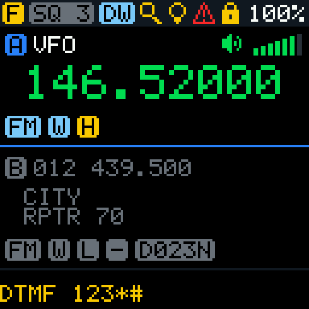
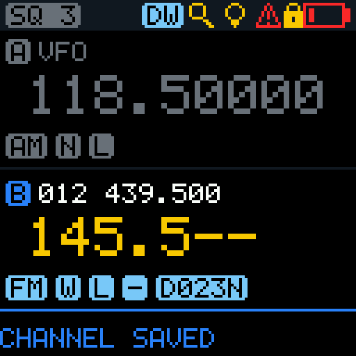
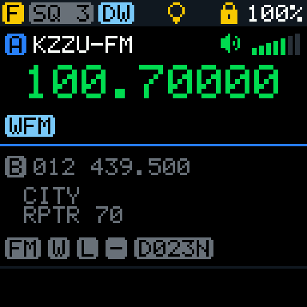
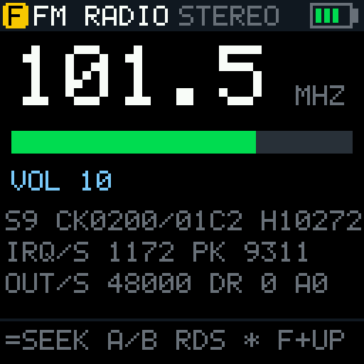
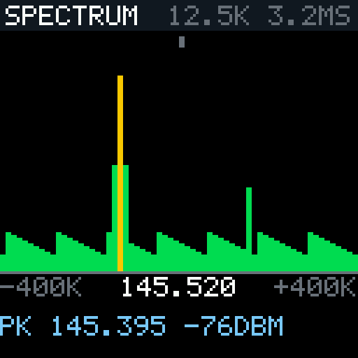
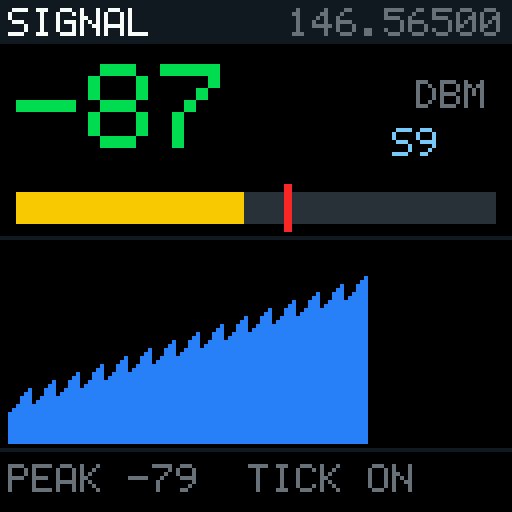
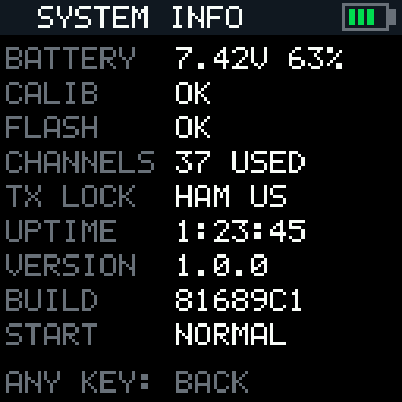

# Open-UV5R-Mini

Open-source firmware for the **Baofeng UV-5R Mini** (NRF kind, stock V0.27), written in C and built only with open
tools. The idea is the same as the UV-K5's open firmware: a radio you can change yourself.

**Release 1.0.0 is the first version with a number, not a finished radio.** Our build runs on one radio: screen,
every key, receive and squelch, transmit, the apps, FM broadcast and the Bluetooth scanner were each checked on it.
Much else, including everything new in 1.0.0, is tested on the PC only ([docs/ROADMAP.md](docs/ROADMAP.md) says
which). No build is known to be safe to flash. Before you try it, read [docs/TESTING.md](docs/TESTING.md) and be
ready to open the case and use the ROM rescue route.

The firmware is our own code plus third-party code whose licence allows it ([docs/THIRD-PARTY.md](docs/THIRD-PARTY.md)):
JieLi's Apache-2.0 libraries for the FM receiver, audio and Bluetooth. Baofeng's stock firmware is used only as a
reference for how the hardware works; none of it is in this repo or in our builds.

## Which radio

There are two kinds of UV-5R Mini with `Hardware:V1.7`: the same radio with two builds of the stock firmware. To see
which one you have:
- **MENU › Radio Info** shows the Firmware line.
- Switch the radio off, then hold **8** while you switch it on. For about a second the screen shows the suffix.

| Suffix | Firmware | Stock file | Status here |
| --- | --- | --- | --- |
| `5RMINI NRF` | `V0.27` | [stock-nrf-v0.27.ufw](https://mega.nz/file/U5NSDIhZ#DqRVur6RPVay1ylKZFQsz2zrXnR3ZrAMBToPHgPnPvQ) | the only kind our firmware is built for |
| `5RMINI NRFB` | `V0.04` | [stock-nrfb-v0.04.ufw](https://mega.nz/file/NgFkWZTS#l4b9-Z6dSISLWBNc8OWMHYUfmzyFV_WT9f268APxnt0) | studied (unpacked, disassembled, lifted to C); no build for it |

NRFB's settings area sits 4 KB further on, so **never flash a file made for one kind onto the other**. The web
flasher and `tools/setup.py` accept only the stock file whose SHA-256 they know.

The stock files are unofficial copies shared by a third party, the same ones
[Codeplug Studio](https://codeplug.mm9pdy.net) links to. This repo only links to them.

## What 1.0.0 has

| Part | State |
| --- | --- |
| Receive: frequency entry, squelch, S-meter, audio | **works on a radio** (2026-11-21) |
| Screen and keypad: A and B together, icons, menu in sections, typing text on the keypad | **works on a radio** |
| Transmit, with a TX lock (ham bands by default; GMRS / PMR446 / UHF CB by region; unlocked) | **transmits on a radio** (2026-11-24); VOX, PTT-ID and roger beep written, not all tried |
| Each VFO (A, B) with its own squelch | new in 1.0.0; PC-tested |
| Broadcast FM in the VFO: tune to 87.5–108 MHz and it plays on the chip's FM receiver (WFM), back on the BK4819 when tuned away | new in 1.0.0; PC-checked only |
| Channels, A/B, scanning, CTCSS/DCS, DTMF, battery save and sleep, saving settings the stock way | written the stock way; PC-tested, not all tried on a radio |
| Dual watch | didn't receive on a radio (2026-11-22); fixed on the PC, not tried again |
| Crash handling: watchdog restart, a note on what crashed, a safe start after early restarts in a row | new in 1.0.0; PC-checked only |
| Cable update mode (PTT-A + `=` at power-on), so the radio can be flashed again | **works on one radio at 9600** (2026-11-22), ours in and stock back, both ways |
| Web builder and flasher (build in the browser, flash over Web Serial) | **flashed one radio from stock to ours** (2026-11-27) |
| CHIRP programming, over the cable or Bluetooth | CHIRP's own UV-5R Mini driver works against ours on the PC (`tests/chirp_host.py`); not yet on a radio |
| Apps: spectrum, signal meter, channel book, snake; system info | **work on a radio** (2026-11-24) |
| FM broadcast radio app, with RDS | **plays on a radio** (2026-11-26); RDS decodes, weakly |
| APRS (beacon out, packets in); sub-GHz remotes (receive only) | written, PC-tested; the sub-GHz receiver saw a remote on a radio but couldn't decode it |
| Bluetooth (BLE): scanner, beacon, info | **work on a radio** (2026-11-27) |
| Bluetooth (BLE): serial link, CHIRP over Bluetooth, pairing | written; PC- and emulator-tested |
| Remote control from the PC over the cable (debug builds only) | works (screen text, keys, registers; also as MCP tools) |
| Clock on the screen, voice prompts, digital voice, FM transmit, NRFB builds | to do |

What was tried on a radio was tried on one radio, by one person. Details and the order of work:
**[docs/ROADMAP.md](docs/ROADMAP.md)**.

## What's on the radio

| Menu | What |
| --- | --- |
| CHANNEL, SCAN, TRANSMIT, SYSTEM | the radio's settings, as stock's, numbered on across the sections |
| APPS | FM RADIO, SPECTRUM, SIGNAL METER, CHANNELS, APRS, SUB-GHZ, SNAKE |
| BLUETOOTH | BLE SCAN, BT BEACON, BT SERIAL, BT CHIRP, BT INFO ([docs/BLUETOOTH.md](docs/BLUETOOTH.md)) |
| ABOUT | name, version, build, radio kind; **1** opens SYSTEM INFO |

Bandwidth (MENU › BANDWIDTH or the BW key) is WIDE, NARROW, or BROADCAST between 64 and 108 MHz. Text (channel
names, call signs) is typed on the keypad as on a phone: 2 = A B C, F switches to numbers. Each app has its own
switch in `features.mk`; the web flasher starts with Bluetooth, SUB-GHZ and APRS off, as experimental. Keys, menus
and typing: **[docs/RADIO.md](docs/RADIO.md)**.

## Screenshots

Drawn on a PC by the firmware's own screen code (`python tests/ui_preview.py --screenshots`), 4x size.

| Main screen | Receiving, long channel name on B | Typing a frequency | Broadcast FM in the VFO |
| --- | --- | --- | --- |
|  |  |  |  |

| Menu: sections | A section, numbered on from the last | Typing a channel name (ABC: letters) | Hidden items (switched on with `=` held) |
| --- | --- | --- | --- |
|  |  |  |  |

| FM radio | Spectrum | Signal meter | Channel book | System info | Snake |
| --- | --- | --- | --- | --- | --- |
|  |  |  |  |  |  |

## Getting it on a radio

Read [docs/TESTING.md](docs/TESTING.md) first: back up your radio's flash (it holds your calibration) and know the
rescue route. Then either:

- **The web flasher** (Chrome or Edge on a desktop): <https://megathelegend.github.io/Open-UV5R-Mini/>. It builds
  the firmware in your browser with the switches you pick, fetches the stock file and MM9PDY's loader patch itself,
  checks everything and flashes over the K1 cable. How it works: [docs/WEB-FLASHER.md](docs/WEB-FLASHER.md).
- **Your own build**: [docs/BUILDING.md](docs/BUILDING.md) has every step, from the tools to a file on the radio. In
  short, after the one-time set-up: `make ufw TOOLCHAIN=<pi32v2-llvm>/bin`.

A release tag (`v1.0.0`) makes a draft GitHub release with `firmware.bin` for a few switch sets, never a `.ufw` (that
would hold Baofeng's loader); `tools/mkufw.py` or the web flasher combines one with your own stock file.

## Working on it

Download the stock file for your radio (links above) into `firmware/`. It isn't in this repo, because it's
Baofeng's code.

```powershell
python tools/setup.py                                                      # check and unpack it into build/
python tools/build_matching.py --toolchain <pi32v2-llvm>/bin --isa <pi32v2-isa>  # rebuild stock from source
python tools/uv5r_flasher.py                                               # flasher, with an emulated radio to practise on
```

Using Claude Code or another AI agent? Point it at [AGENTS.md](AGENTS.md): the rules, the context and how to
contribute.

| Folder | What's in it |
| --- | --- |
| `src/` | The radio firmware: `driver/` (chips), `radio/` (radio behaviour), `store/` (calibration, channels, settings), `app/` (keys, main loop, apps), `ui/` (screens, icons), `update/` (cable update mode), `bt/` (Bluetooth), `platform/jl_sdk/` (glue for JieLi's libraries), `bsp/` |
| `assets/` | Icons as editable pixel-art text, turned into C by `tools/mkassets.py` |
| `tools/` | Unpack, build, check and flash `.ufw` files; disassembler; `tools/lift/` turns stock code into C; remote control (`radiomon.py`), Bluetooth bridge for CHIRP (`ble_serial.py`), sub-GHz helpers |
| `web/` | The web builder and flasher |
| `emu/` | Emulator that runs the real firmware on the PC, for tracing what the stock code does |
| `tests/` | Tests run on the PC, and a preview of the screen (`tests/ui_preview.py`) |
| `docs/` | Everything else, listed below |
| `build/` | Generated locally; never committed (it holds stock-derived files) |

Folder rules, naming and how assets are stored: **[docs/LAYOUT.md](docs/LAYOUT.md)**.

## Docs

| Doc | Read it for |
| --- | --- |
| [ROADMAP](docs/ROADMAP.md) | What's done, what was tried on a radio, and what's next |
| [RADIO](docs/RADIO.md) | Using the firmware: keys, menus, typing text, remote control from the PC |
| [TESTING](docs/TESTING.md) | Flashing a radio safely, crashes, and getting back to stock |
| [BUILDING](docs/BUILDING.md) | Building the firmware and putting it on a radio: tools, commands, feature switches |
| [WEB-FLASHER](docs/WEB-FLASHER.md) | The web builder and flasher: use, what the site holds, tests |
| [BLUETOOTH](docs/BLUETOOTH.md) | Bluetooth: the apps, CHIRP over Bluetooth, pairing, how the BLE backend works |
| [LAYOUT](docs/LAYOUT.md) | Where code goes, naming, and how icons and other assets are stored |
| [PORTING](docs/PORTING.md) | How the C firmware was brought up on this chip |
| [MATCHING](docs/MATCHING.md) | The byte-for-byte stock rebuild, and making small mods |
| [RE-NOTES](docs/RE-NOTES.md) | Hardware findings: pins, chips, memory |
| [FIRMWARE](docs/FIRMWARE.md) | The `.ufw` file format |
| [UPDATE-MODE](docs/UPDATE-MODE.md) | How the radio receives new firmware |
| [EMULATOR](docs/EMULATOR.md) | The emulator |
| [LIFTER](docs/LIFTER.md) | Stock code to C, and the AI rewrite tool |
| [K5-FEATURES](docs/K5-FEATURES.md) | The UV-K5 custom firmware's features, and which of them we have |
| [THIRD-PARTY](docs/THIRD-PARTY.md) | Third-party code and libraries, and their licences |

## Licence

Not chosen yet: until it is, this repo has no licence of its own. Third-party parts keep theirs
([docs/THIRD-PARTY.md](docs/THIRD-PARTY.md)).
