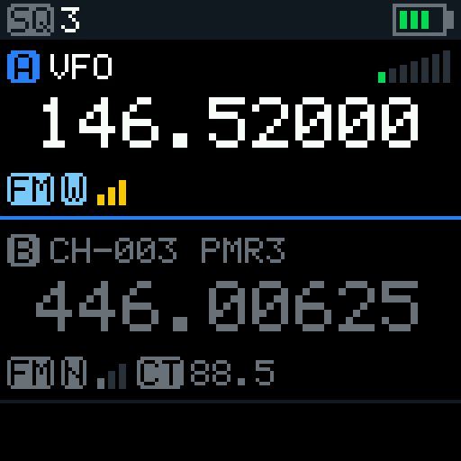
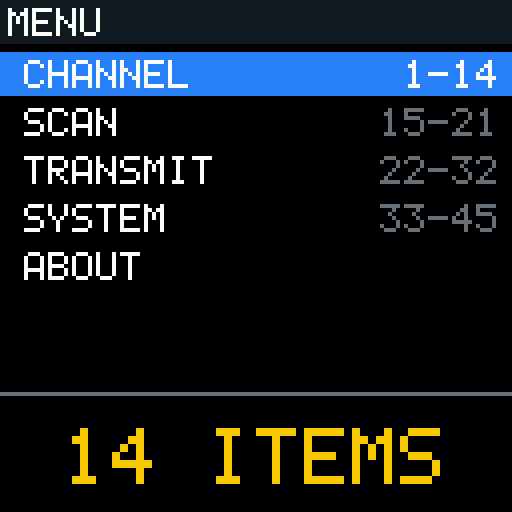
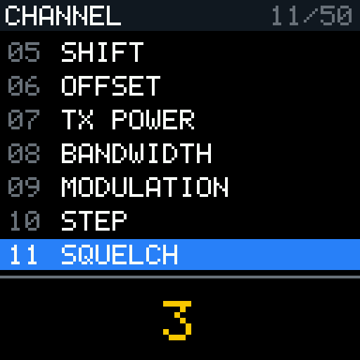
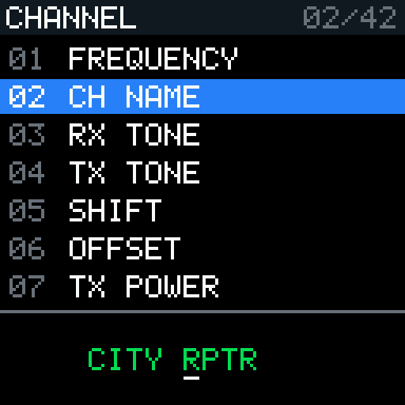
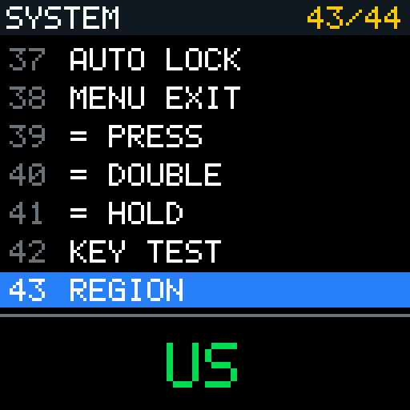
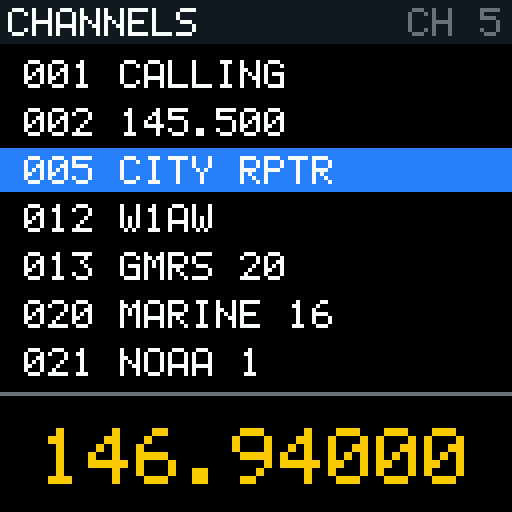
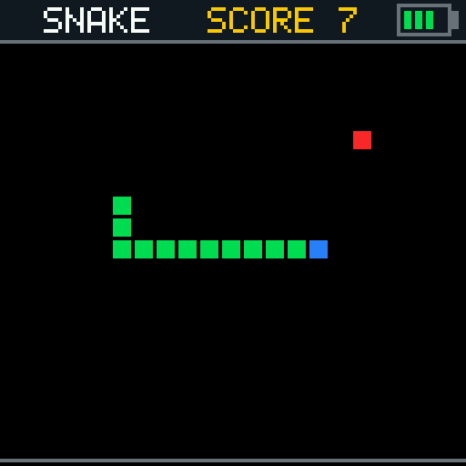

# Open-UV5R-Mini

Open-source firmware for the **Baofeng UV-5R Mini**, built only with open tools. The idea is the same as the UV-K5's
open firmware: a radio you can change in plain C.

**Early, not ready for everyday use.** The firmware is our own code plus third-party code whose licence allows it
([docs/THIRD-PARTY.md](docs/THIRD-PARTY.md)); the stock firmware is used only as a reference for how the hardware
works. Our own build runs on a radio: screen, every key, receive audio and squelch (2026-11-21), transmit
(2026-11-24), the apps and FM broadcast radio (2026-11-26), and the Bluetooth scanner and beacon (2026-11-27) were
checked on one radio. Much else is written and tested on the PC only ([docs/ROADMAP.md](docs/ROADMAP.md)). On one radio (2026-11-22) our build was installed from stock, and stock put back, with only
the programming cable (`tools/uv5r_flasher.py --loader-baud 9600`, about 10 minutes). That is one radio: keep the
case-open ROM rescue route ([docs/TESTING.md](docs/TESTING.md)) at hand, and don't try it unless you can use it.

## Which radio

There are two kinds of UV-5R Mini with `Hardware:V1.7`. They are the same radio, with two builds of the same stock
firmware. To see which one you have:
- **MENU › Radio Info** shows the Firmware line.
- Switch the radio off, then hold **8** while you switch it on. For about a second the screen shows the suffix.

| Suffix | Firmware | Stock file | Status here |
| --- | --- | --- | --- |
| `5RMINI NRF` | `V0.27` | [stock-nrf-v0.27.ufw](https://mega.nz/file/U5NSDIhZ#DqRVur6RPVay1ylKZFQsz2zrXnR3ZrAMBToPHgPnPvQ) | main target |
| `5RMINI NRFB` | `V0.04` | [stock-nrfb-v0.04.ufw](https://mega.nz/file/NgFkWZTS#l4b9-Z6dSISLWBNc8OWMHYUfmzyFV_WT9f268APxnt0) | unpacked, disassembled and lifted to C; builds still NRF-only |

The two builds differ only slightly. NRFB's app is 596 bytes bigger, and that moves the settings area along by
4 KB. Never flash a file made for one kind onto the other.

The stock files are unofficial copies shared by a third party, the same ones
[Codeplug Studio](https://codeplug.mm9pdy.net) links to. This repo only links to them. `tools/setup.py` checks
the file against its pinned SHA-256 and refuses any other file.

## How far it is

| Part | State |
| --- | --- |
| Stock firmware rebuilt from source with open tools, byte for byte | done |
| Small mods to the stock firmware, as a flashable patch (demo: boot text `OPENUV NRF`) | done, not yet tried on a radio |
| Flasher with a built-in emulated radio, for practice | done |
| Stock code turned into C and checked against the original (reference for porting) | done |
| Own firmware: receiving (frequency, squelch, RSSI bar, audio) | **works on a radio** |
| Own firmware: screen and keypad (every key), main screen with A and B together and icons | **works on a radio** |
| Own firmware: dual watch | written; **doesn't work on a radio yet** (bug) |
| CHIRP programming, over the cable or Bluetooth | written: CHIRP's own UV-5R Mini driver, unchanged, downloads and uploads on the PC (`tests/chirp_host.py`); over Bluetooth with BT CHIRP and `tools/ble_serial.py`; not yet on a radio. Codeplug Studio not tried |
| Own firmware: cable update mode (so a radio can always be flashed again) | **works on one radio at 9600** (2026-11-22): ours installed and stock put back over the cable, both ways twice; 38400 and the official updater still to do |
| Own firmware: channels, A/B and dual watch, scanning, CTCSS/DCS, DTMF, battery, menu | written the stock way; PC-tested, not all tried on a radio |
| Own firmware: transmit, with a TX lock (ham, GMRS / PMR446 / UHF CB by region, unlocked) | **transmits on a radio** (2026-11-24); VOX, PTT-ID and roger beep written, not all tried |
| Own firmware: saving settings and channels; channel names typed on the keypad | on; PC-tested |
| Apps: spectrum, signal meter, channel book, system info, snake | **work on a radio** (2026-11-24) |
| FM broadcast radio (the chip's own FM receiver), with RDS | **plays on a radio** (2026-11-26); RDS decodes, weak |
| APRS (beacon out, packets in), sub-GHz remotes (receive) | written; tried on a radio: the sub-GHz receiver sees a remote but can't decode it (ROADMAP 3.15) |
| Bluetooth (BLE): scanner, beacon, info | **work on a radio** (2026-11-27) |
| Bluetooth (BLE): serial link, CHIRP over Bluetooth, pairing mode (passkey on the radio) | written; PC- and emulator-tested |
| Remote control from the PC over the cable (debug builds) | works (screen text, keys, registers; also as MCP tools) |
| Own firmware: clocks, timer interrupts, voice prompts | to do |

Details and the order of work: **[docs/ROADMAP.md](docs/ROADMAP.md)**.

## What's on the radio

| Menu | What |
| --- | --- |
| CHANNEL, SCAN, TRANSMIT, SYSTEM | the radio's settings, as stock's, numbered on across the sections |
| APPS | FM RADIO, SPECTRUM, SIGNAL METER, CHANNELS, APRS, SUB-GHZ, SYSTEM INFO, SNAKE |
| BLUETOOTH | BLE SCAN, BT BEACON, BT SERIAL, BT CHIRP, BT INFO ([docs/BLUETOOTH.md](docs/BLUETOOTH.md)) |
| ABOUT | name, version, build |

Text (channel names, call signs) is typed on the keypad as on a phone: 2 = A B C, F switches to numbers. Each app
is its own switch in `features.mk`. Keys, menus and typing: **[docs/RADIO.md](docs/RADIO.md)**.

## Screenshots

Drawn on a PC by the firmware's own screen code (`python tests/ui_preview.py --screenshots`), 4x size.

| Main screen | Receiving, long channel name on B | Typing a frequency |
| --- | --- | --- |
|  |  |  |

| Menu: sections | A section, numbered on from the last | Typing a channel name (ABC: letters) | Hidden items (switched on with `=` held) |
| --- | --- | --- | --- |
|  |  |  |  |

| FM radio | Spectrum | Signal meter | Channel book | System info | Snake |
| --- | --- | --- | --- | --- | --- |
|  |  |  |  |  |  |

## Find your way

| Folder | What's in it |
| --- | --- |
| `src/` | The radio firmware: `driver/` (chips), `radio/` (radio behaviour), `store/` (calibration, channels, settings), `app/` (keys, main loop), `ui/` (screens, icons), `update/` (cable update mode), `bsp/`, `bt/` |
| `assets/` | Icons as editable pixel-art text, turned into C by `tools/mkassets.py` |
| `tools/` | Unpack, build, check and flash `.ufw` files; disassembler; `tools/lift/` turns stock code into C; remote control (`radiomon.py`), Bluetooth bridge for CHIRP (`ble_serial.py`), sub-GHz helpers |
| `emu/` | Emulator that runs the real firmware on the PC, for tracing what the stock code does |
| `tests/` | Tests run on the PC, and a preview of the screen (`tests/ui_preview.py`) |
| `docs/` | Everything else, listed below |
| `build/` | Generated locally; never committed (it holds stock-derived files) |

Folder rules, naming and how assets are stored: **[docs/LAYOUT.md](docs/LAYOUT.md)**.

## Getting started

Download the stock file for your radio (links above) into `firmware/`. It isn't in this repo, because it's
Baofeng's code.

```powershell
python tools/setup.py                                                      # check and unpack it into build/
python tools/build_matching.py --toolchain <pi32v2-llvm>/bin --isa <pi32v2-isa>  # rebuild stock from source
python tools/uv5r_flasher.py                                               # flasher, with an emulated radio to practise on
```

Building the firmware: **[docs/BUILDING.md](docs/BUILDING.md)** has every step and command, from the tools to a
file on the radio. In short, after the one-time set-up: `make ufw TOOLCHAIN=<pi32v2-llvm>/bin`.

Using Claude Code or another AI agent? Point it at [AGENTS.md](AGENTS.md): the rules, the context and how to
contribute.

## Docs

| Doc | Read it for |
| --- | --- |
| [ROADMAP](docs/ROADMAP.md) | What's done and what's next |
| [LAYOUT](docs/LAYOUT.md) | Where code goes, naming, and how icons and other assets are stored |
| [RADIO](docs/RADIO.md) | The radio app: what it does, the keys, typing text, remote control from the PC, how to test it |
| [TESTING](docs/TESTING.md) | Flashing a radio safely, and getting back to stock |
| [BUILDING](docs/BUILDING.md) | Building the firmware and putting it on a radio: tools, commands, feature switches |
| [PORTING](docs/PORTING.md) | How the C firmware was brought up on this chip |
| [MATCHING](docs/MATCHING.md) | The byte-for-byte stock rebuild, and making small mods |
| [RE-NOTES](docs/RE-NOTES.md) | Hardware findings: pins, chips, memory |
| [FIRMWARE](docs/FIRMWARE.md) | The `.ufw` file format |
| [UPDATE-MODE](docs/UPDATE-MODE.md) | How the radio receives new firmware |
| [EMULATOR](docs/EMULATOR.md) | The emulator |
| [LIFTER](docs/LIFTER.md) | Stock code to C, and the AI rewrite tool |
| [BLUETOOTH](docs/BLUETOOTH.md) | Bluetooth: the apps, CHIRP over Bluetooth, how the BLE backend works |
| [K5-FEATURES](docs/K5-FEATURES.md) | The UV-K5 custom firmware's features, and which of them we have |
| [THIRD-PARTY](docs/THIRD-PARTY.md) | Third-party code and libraries, and their licences |

## Licence

TBD.
